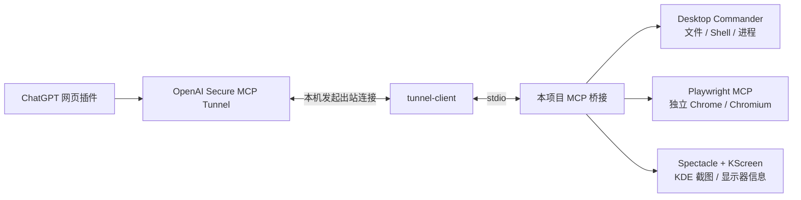

# ChatGPT Remote Control

通过 **ChatGPT 网页端 → OpenAI Secure MCP Tunnel → 本机 MCP 桥接**，操作你自己的 Linux 电脑：读写文件、执行命令、控制浏览器，以及截取 KDE 桌面。

[English](README.en.md) · [配置说明](docs/configuration.md) · [排错与验收](docs/troubleshooting.md) · [验证记录](docs/validation.md) · [权限与数据](SECURITY.md)

本项目来自一套已经在 CachyOS / KDE Wayland 上完成网页端实际调用验证的部署。公开版本把机器名、用户目录、浏览器位置和代理改为本机配置，提供可重复安装与独立验证脚本。它是社区集成项目，不是 OpenAI 官方远程桌面产品。

## 能做什么

| 能力 | 实现 | 当前状态 |
| --- | --- | --- |
| 文件读取、写入、编辑、搜索和进程操作 | Desktop Commander | 已验证 |
| 网页读取、点击、中文输入、表单、标签页、上传下载 | Playwright MCP | 已验证 |
| 独立可见浏览器及登录状态保存 | Chrome / Chromium 持久配置 | 已验证 |
| 全桌面、活动窗口截图及显示器信息 | KDE Spectacle / KScreen | 已验证图像采集与返回 |
| ChatGPT 根据截图理解屏幕 | 取决于网页客户端图像支持 | **不保证；当前验证环境存在限制** |
| 任意桌面应用的鼠标和键盘控制 | 尚未接入 | 不支持 |

全部启用时，固定版本提供 **53 个工具**：26 个 Desktop Commander 工具、25 个浏览器工具、2 个桌面工具。浏览器操作使用网页结构和元素引用，不依赖截图视觉。



无需为 MCP 服务开放公网入站端口。健康检查仅绑定本机回环地址。浏览器不开放外部调试端口。

## 前提条件

- Linux **x86_64**，systemd 用户服务，Python **3.10+**，Node.js **22+** 和 npm。
- 浏览器功能需要已安装 Chrome 或 Chromium，以及可用的图形会话。
- 桌面截图需要 KDE Plasma、`spectacle` 和 `kscreen-doctor`；验证环境为 KDE Wayland。其他桌面可用 `--no-desktop` 关闭截图功能。
- ChatGPT 账号/工作区能够创建开发者插件，并提供 **Tunnel** 连接选项。此能力是否可用以账号实际界面为准，本项目不能开通账号权限。
- 已在相应组织创建 Secure MCP Tunnel，并持有具备所需 **Tunnels Read + Use** 权限的 runtime key。创建 Tunnel 所需的管理权限与运行权限不同，见[官方文档](https://developers.openai.com/api/docs/guides/secure-mcp-tunnels)。

每台同时运行的电脑使用自己的 Tunnel ID。同一组织内权限合适的 runtime key 可以复用；不要让两个活动 stdio 客户端共用一个 Tunnel ID。

## 安装

在目标电脑的本机终端执行，**不要使用 sudo 运行安装程序**：

```bash
git clone https://github.com/a820936422/chatgpt-remote-control.git
cd chatgpt-remote-control
python3 scripts/deploy.py install
```

安装程序复制项目到用户数据目录，执行锁文件安装，下载并校验固定版本的官方 Tunnel 客户端，生成配置和 systemd 用户服务。不会在安装阶段填写凭据或启动连接。

可选参数示例：

```bash
# 指定现有 Node 和浏览器
python3 scripts/deploy.py install --node /usr/bin/node --browser /usr/bin/chromium

# 需要代理时才设置；按你的本机代理地址填写
python3 scripts/deploy.py install --proxy http://127.0.0.1:7897

# 非 KDE 桌面，保留文件、命令与浏览器功能
python3 scripts/deploy.py install --no-desktop

# 仅文件和命令功能，可在无图形会话的机器使用
python3 scripts/deploy.py install --no-desktop --no-browser
```

运行期间显示进度、耗时和内存信息。第一次安装需要从 GitHub 和 npm 下载依赖。安装不下载额外浏览器，使用你指定或自动发现的现有浏览器。

### 在本机输入凭据

```bash
python3 scripts/deploy.py configure
```

输入 Tunnel ID，再粘贴 runtime key。**密钥输入不回显**，保存到私有目录内权限为 `600` 的 `runtime.env`。不要把真实 key 放进仓库、聊天、Shell 命令参数或截图。

配置程序启用并重启用户服务，检查本机健康状态。默认健康端口为 **18081**，安装时可用 `--health-port` 更改。本机健康通过只说明连接进程就绪，仍需要网页端实际调用验收。

### 在 ChatGPT 添加插件

1. 按账号界面启用 Developer mode，打开 <https://chatgpt.com/plugins>。
2. 创建插件，名称可用 `desktop-connector`，Connection 选择 **Tunnel**。
3. 选择给这台电脑创建的 Tunnel，Authentication 选择 **None / No Authentication**。
4. 扫描工具并保存。工具有启用开关时，启用需要的文件写入和 `browser_*` 工具。
5. 新建聊天，选择该插件。

此处的 None 是 MCP 应用层设置；Tunnel 仍由 runtime key 认证。不要把 runtime key 填到 OAuth 输入框中。

以后新增或调整工具，需要刷新/重新扫描插件定义并新建聊天；本机服务重启不会保证网页自动更新工具缓存。

## 使用与验收

将提示中的插件名称替换成你实际设置的名称。

**浏览器：**

> 使用 desktop-connector 的 browser_navigate，在本机浏览器打开 https://example.com/。调用 browser_snapshot 读取标题和正文，再根据快照的元素引用点击 Learn more，报告跳转后的网址和标题。请实际调用 browser_* 工具，完成后用 browser_close 关闭自动化浏览器。

首次浏览器操作会在本机打开一个独立窗口。网站需要登录时，在此窗口手动登录；该专用浏览器会保留持久 Cookie 和本地存储，网站仍可能要求重新登录。它不接管日常浏览器的 ChatGPT 标签页。不要让多个聊天同时操作这个共享浏览器状态。

**文件：**

> 在我的下载目录新建一个不重名的验证文本文件，写入“ChatGPT 写入验证成功”，再用 read_file 读回并核对。

**桌面截图：**

> 实际调用 desktop_screenshot 截取当前桌面。如果图像确实作为视觉输入可见，请描述看到的内容；如果只有 JPEG 数据或元数据，请明确说明，不要猜测窗口内容。

`desktop_screenshot` 返回 MCP 图像块。采集临时文件在返回前清理。Playwright 的 `browser_take_screenshot` 不传 `filename` 时返回图像及保存结果；传入 `filename` 时仅返回文件引用。收到图片数据、组件显示图片、模型理解图片是不同的验收环节。

## 日常管理

```bash
python3 scripts/deploy.py status
systemctl --user stop chatgpt-remote-control.service
systemctl --user start chatgpt-remote-control.service
systemctl --user disable --now chatgpt-remote-control.service
```

服务随用户登录启动。本项目不启用 linger、不改变休眠策略。截图和可见浏览器依赖已登录的图形会话。需要停止浏览器但保留文件工具时，可调用 `browser_close`。

更新时先停止服务，拉取代码，再执行安装命令。已有用户配置和凭据默认保留；改配置前请阅读 [配置说明](docs/configuration.md)。

```bash
systemctl --user stop chatgpt-remote-control.service
git pull --ff-only
python3 scripts/deploy.py install
systemctl --user start chatgpt-remote-control.service
```

卸载服务：`python3 scripts/deploy.py uninstall`。此操作保留程序、凭据、浏览器登录资料和下载文件，方便恢复；不会隐式清空个人资料。

## 开发和验证

```bash
npm ci --ignore-scripts
npm test
npm run test:python
npm run test:integration

# 本机有 KDE 图形会话和 Chrome / Chromium 时
npm run test:desktop
```

测试创建临时 HOME、配置和浏览器资料，不需要 Tunnel key，不修改已运行的生产连接。可通过 `CRC_TEST_BROWSER` 指定浏览器路径。CI 运行单元测试与无桌面依赖的 MCP 集成测试；图形操作需在本机运行最后一项。截图不会作为测试产物提交。

| 组件 | 固定版本 |
| --- | --- |
| OpenAI tunnel-client | 0.0.14，Linux amd64，SHA-256 校验 |
| Desktop Commander | 0.2.51 |
| Playwright MCP | 0.0.82 |
| MCP TypeScript SDK | 1.30.0 |
| sharp | 0.35.4（含上游 Desktop Commander 的安全覆盖） |

完整 npm 依赖由 `package-lock.json` 锁定。升级任何上游后都应重新验证工具列表、资源读取和浏览器行为；不能只检查 `/healthz`。

公开版本覆盖了 Desktop Commander 的 sharp 依赖以及 ExcelJS 的 uuid 依赖（11.1.1），修复发布检查时已知的上游安全公告影响。图像转换和 Excel 读写均有兼容性测试；具体说明见 [SECURITY.md](SECURITY.md)。

## 目录

```text
src/                  MCP 桥接、配置、桌面截图、上游连接
scripts/deploy.py     安装、隐藏凭据输入、状态、卸载服务
scripts/run_tunnel.py systemd 的 Tunnel 启动入口
scripts/verify.mjs    实际 MCP 与图形功能验收
examples/            无凭据的配置示例
tests/               配置、路由、取消、部署与凭据写入测试
docs/                配置与排错说明
```

本项目代码采用 [MIT License](LICENSE)。第三方软件遵循各自许可证，参见 [THIRD_PARTY_NOTICES.md](THIRD_PARTY_NOTICES.md)。
